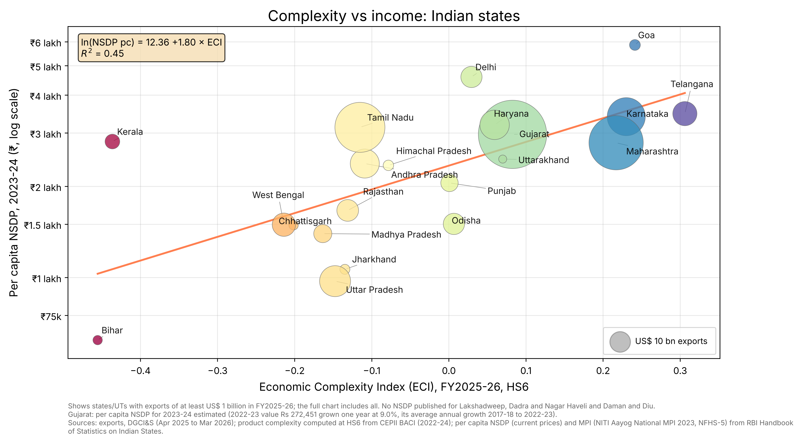
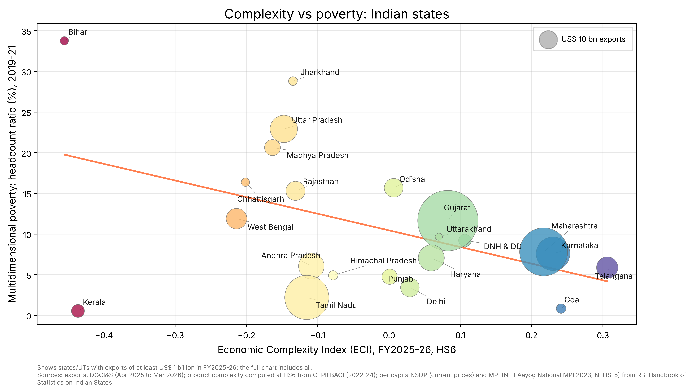

# Economic complexity of Indian states, FY2025-26

Do Indian states that export more complex products tend to be richer and less poor?
This repository measures the **economic complexity (ECI)** of every Indian state and
union territory from its FY2025-26 exports at the 6-digit product level, and compares
it with **per capita income** (NSDP) and **multidimensional poverty** (NITI Aayog MPI).

This is the code and data behind the Indian Westerlies post
**Why High-Tech Matters for Growth: Evidence from Indian States**
([indianwesterlies.substack.com](https://indianwesterlies.substack.com)).
Every number and chart in that post can be rebuilt from public data with the
scripts in `scripts/`; see [Where each number in the post comes from](#where-each-number-in-the-post-comes-from).

## Headline results

States with FY2025-26 exports of at least US$ 1 billion (bubble size = exports):





| chart | states | R² |
|---|---|---|
| ECI vs per capita NSDP (log), main | 21 | 0.45 |
| ECI vs MPI headcount ratio, main | 22 | 0.21 |
| ECI vs per capita NSDP, all states/UTs | 34 | 0.19 |
| ECI vs MPI headcount ratio, all states/UTs | 36 | 0.15 |

- **Income.** Among the main states, a 0.1 higher ECI goes with about 20% higher
  per capita NSDP. Complexity accounts for a little under half the variation.
- **Below the income line.** Uttar Pradesh is furthest below it (1.5 standard
  deviations; the line predicts about 1.8 times its actual income), then Jharkhand
  and Bihar.
- **Above the income line.** Kerala (2.4 standard deviations), then Delhi and Tamil
  Nadu. Remittances, tourism and services do not appear in goods exports.
- **Poverty.** A 0.1 higher ECI goes with about 2 percentage points lower MPI
  headcount, a looser link (R² 0.21). Bihar, Jharkhand and Uttar Pradesh are
  poorer than the line predicts; Kerala and Tamil Nadu much less poor.
- These are correlations across about 20 states. They do not show that complexity
  causes higher income or lower poverty.

Fig 1 in the post (ECI vs GDP per capita across countries) is OEC's chart and is
not produced here.

Full numbers: `outputs/figures/fit_stats.md`. Charts with all states/UTs:
`outputs/figures/full_eci_vs_nsdp.png`, `outputs/figures/full_eci_vs_mpi.png`.

## How it works, in plain words

1. **What each state exports.** DGCI&S publishes exports by state of origin and
   product. We use April 2025 to March 2026 at HS6 (about 5,200 product codes).
2. **How complex each product is (PCI).** A product is complex if few countries
   export it competitively, and those that do also export many other things.
   We compute this from world trade (CEPII BACI, 2022-2024 average, 130 countries,
   4,673 HS6 products) with the standard Hidalgo-Hausmann method. Our numbers match
   the Observatory of Economic Complexity's published HS6 PCI closely (r = 0.99).
3. **Which products each state is good at.** A state has a revealed comparative
   advantage (RCA) in a product if that product's share in the state's exports is
   at least its share in India's exports.
4. **State ECI** = the average PCI of the products where the state has RCA >= 1.
   This is how OEC measures complexity for regions inside a country: product
   complexity comes from the world, state specialisation from Indian data.
5. **Compare** with per capita NSDP (2023-24) and MPI headcount ratio (2019-21)
   from the RBI Handbook of Statistics on Indian States.

## Why 6-digit products matter

Coarser product codes can hide very different products in one bucket. Two
examples from `data/processed/pci_hs6.csv` (PCI is a z-score; 0 is average):

| product | HS4 bucket PCI (OEC) | HS6 PCI (ours) |
|---|---|---|
| Smartphones (851713) | 0.57 (heading 8517, phones and network gear) | -0.18 |
| Network switching/routing equipment (851762) | 0.57 | 0.52 |
| Rough diamonds, non-industrial (710231) | -1.73 (heading 7102) | -1.65 |
| Cut and polished diamonds (710239) | -1.73 | -0.58 |

## Reproduce

Requires Python 3.10+ and about 2 GB of free disk for the world trade download.

```bash
pip install -r requirements.txt

# 1. State exports: raw files are in the repo
python scripts/clean_dgcis_am26.py

# 2. Product complexity from world trade (one-time download, ~300 MB zip)
mkdir -p data/external/baci
curl -L -o data/external/baci/BACI_HS22_V202601.zip \
  https://www.cepii.fr/DATA_DOWNLOAD/baci/data/BACI_HS22_V202601.zip
unzip data/external/baci/BACI_HS22_V202601.zip -d data/external/baci
python scripts/fetch_oec_reference.py     # OEC benchmarks for validation
python scripts/aggregate_baci.py
python scripts/compute_pci_hs6.py

# 3. State ECI, income and poverty, charts
python scripts/compute_state_eci.py
python scripts/fetch_rbi_handbook.py
python scripts/build_state_panel.py
python scripts/plot_state_eci.py
```

This has been tested from a fresh clone in a clean Python environment; the
results match the committed files (chart label positions may shift slightly
between library versions).

Step 2's outputs are committed (`data/processed/pci_hs6.csv` and the collapsed
BACI file), so steps 1 and 3 run without the large download. `fetch_oec_reference.py`
and `fetch_rbi_handbook.py` call public websites that are occasionally slow; both retry.

## Data sources

| data | source | used for |
|---|---|---|
| Exports by state of origin x HS6, Apr 2025 to Mar 2026 | DGCI&S, Ministry of Commerce (downloaded Nov 2026; raw files in `data/raw/dgcis_am26/`) | state specialisation |
| World trade by country x HS6, 2022-2024 | CEPII BACI, HS22, version 202601 (Gaulier & Zignago 2010); Etalab Open Licence 2.0 | product complexity |
| PCI and ECI at HS6/HS4, HS22 | Observatory of Economic Complexity (oec.world) | country sample and validation |
| Per capita NSDP, current prices | RBI Handbook of Statistics on Indian States 2024-25, Table 19 | income |
| MPI headcount ratio, NFHS-5 (2019-21) | NITI Aayog, National Multidimensional Poverty Index 2023, via RBI Handbook Table 10 | poverty |

## Choices and limitations

Please read these before quoting the results.

- **Goods only.** Exports cover merchandise, not services. States with large IT or
  tourism economies (Karnataka, Kerala, Goa, Telangana, Delhi) are only partly
  described by their goods exports.
- **Exports are a proxy for production.** Products made and sold within India do
  not appear. DGCI&S assigns exports to the state of origin reported for each
  shipment.
- **Different years.** Exports are FY2025-26, product complexity 2022-24, income
  2023-24, poverty 2019-21 (the latest MPI available).
- **Income is NSDP, not GSDP.** RBI publishes per capita *net* state domestic
  product; it does not publish GSDP per capita.
- **Gujarat's income is estimated.** RBI has no 2023-24 figure for Gujarat. We grow
  its 2022-23 value (Rs 272,451) by 9.0%, its average annual growth over 2017-18 to
  2022-23, giving Rs 297,010.
- **No income data** for Lakshadweep and Dadra and Nagar Haveli and Daman and Diu;
  they appear only in the poverty charts.
- **Small exporters are noisy.** State ECI is a simple average over products with
  RCA >= 1, so a state exporting a handful of products (Lakshadweep 1, Ladakh 3,
  several north-eastern states 10-40) gets an unreliable value. This is why the main
  charts show only states exporting at least US$ 1 billion. All states are kept in
  `data/processed/state_eci_am26.csv`.
- **Big products do not dominate.** Because ECI is an unweighted average, a state's
  largest export counts the same as its smallest product with RCA >= 1.
- **Merged codes.** BACI and OEC report all refined petroleum (HS 2710) as one code,
  271000, so India's 2710.12 and 2710.19 are mapped to it. In total 99.6% of state
  export value gets a PCI.
- **Our PCI is close to OEC's but not identical.** OEC does not document its exact
  product filter; we keep products with at least US$ 100 million of world trade.
- **Correlation, not causation.**

## Where each number in the post comes from

| in the post | value | file |
|---|---|---|
| exports covered | US$ 441.5 bn, Apr 2025 to Mar 2026; 5,216 HS6 codes | `data/processed/state_totals_am26.csv` |
| countries and products used for complexity | 130 countries, 4,673 HS6 products | `outputs/validation/pci_hs6_validation.md` |
| match with OEC | PCI correlation 0.99 | `outputs/validation/pci_hs6_validation.md` |
| states in the main charts | 22 with exports >= US$ 1 bn, 99.6% of state exports | `data/processed/state_panel_am26.csv` (`in_main_plot`) |
| income: share explained, slope | R² 0.45; 0.1 ECI ~ 20% higher NSDP | `outputs/figures/fit_stats.md` |
| Uttar Pradesh below the line | 1.5 standard deviations; predicted 1.8x actual | `outputs/figures/fit_stats.md` |
| UP's largest export | smartphones, US$ 4.46 bn | `data/processed/state_products_rca_am26.csv` |
| poverty: share explained, slope | R² 0.21; 0.1 ECI ~ 2 points lower headcount | `outputs/figures/fit_stats.md` |
| Gujarat income estimate | Rs 297,010 (2022-23 grown at 9.0%) | `data/processed/state_panel_am26.csv` (`nsdp_note`) |

## About the earlier post

An earlier Indian Westerlies post, [Why Some Indian States Are Richer Than Others](https://indianwesterlies.substack.com/p/why-some-indian-states-are-richer),
asked the same question with FY2024-25 exports at the 4-digit level. It is
superseded by this analysis. It had these problems, which this version fixes:

- **Some MPI values were wrong.** Several states were entered from the older
  NFHS-4 (2015-16) column or mistyped, including Uttar Pradesh (shown as about 37.7%;
  the NFHS-5 figure is 22.9%), Assam, Chhattisgarh, Odisha, Rajasthan, Nagaland and
  Meghalaya. All values now come from NFHS-5 programmatically.
- **The income measure was mislabelled.** The charts said GSDP per capita, but the
  data was per capita NSDP from the same RBI table. It is now labelled correctly.
- **Mixed years.** Income used each state's latest available year (2022-23 to
  2024-25). It now uses 2023-24 for all states.
- **Code link.** The post linked to `Tiru-Kaggundi/State_exports`, which holds only
  port and country data. This repository is the right one.

The ECI values here are not directly comparable with the earlier post's: the year,
the product detail (HS6 instead of HS4) and the source of product complexity all changed.

## Repository layout

```
data/
  raw/dgcis_am26/            DGCI&S downloads, unmodified (7 parts) + SOURCE.md
  reference/state_names.csv  DGCI&S state names -> standard names
  reference/oec/             OEC PCI/ECI benchmarks
  reference/rbi/             RBI Handbook tables (MPI, NSDP, GSDP)
  processed/                 outputs of the scripts (see below)
  external/                  BACI download (not committed)
scripts/
  clean_dgcis_am26.py        raw .xls -> tidy CSV, with validation checks
  fetch_oec_reference.py     OEC benchmarks
  aggregate_baci.py          BACI bilateral flows -> exports by country x HS6 x year
  complexity.py              RCA, Hidalgo-Hausmann ECI/PCI, HS code alignment
  compute_pci_hs6.py         HS6 PCI and country ECI + validation report
  compute_state_eci.py       state RCA and ECI
  fetch_rbi_handbook.py      RBI MPI, NSDP and GSDP tables
  build_state_panel.py       one row per state: ECI, income, poverty
  plot_state_eci.py          the four charts + fit statistics
outputs/
  figures/                   charts (400 dpi) and fit_stats.md
  validation/                pci_hs6_validation.md
```

Main processed files:

| file | contents |
|---|---|
| `state_hs6_exports_am26.csv` | state x HS6 exports, FY2025-26 (US$ and Rs) |
| `pci_hs6.csv` | product complexity for 4,673 HS6 products, with OEC's value alongside |
| `eci_countries_hs6.csv` | country ECI from the same calculation (India 40th of 130) |
| `state_eci_am26.csv` | state ECI, products exported, products with RCA >= 1 |
| `state_products_rca_am26.csv` | every state x product RCA, with PCI |
| `state_panel_am26.csv` | state ECI with income, poverty and chart flags |

## Validation

`outputs/validation/pci_hs6_validation.md` compares our product and country
complexity with OEC's published figures, lists the most and least complex products,
and reports how much of each state's exports has a PCI. In short: PCI r = 0.99 and
country ECI r = 0.997 against OEC; Japan, Switzerland, Taiwan, Germany and Korea rank
top; cocoa, raw cashew and natural rubber rank bottom.

## Licence and citation

Code: free to reuse with attribution. Data remain under their original terms
(DGCI&S, CEPII BACI under Etalab 2.0, OEC, RBI). If you use this, please cite the
Indian Westerlies post and this repository.
